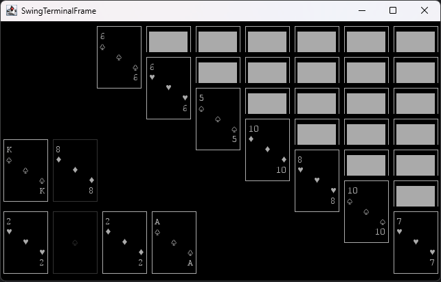
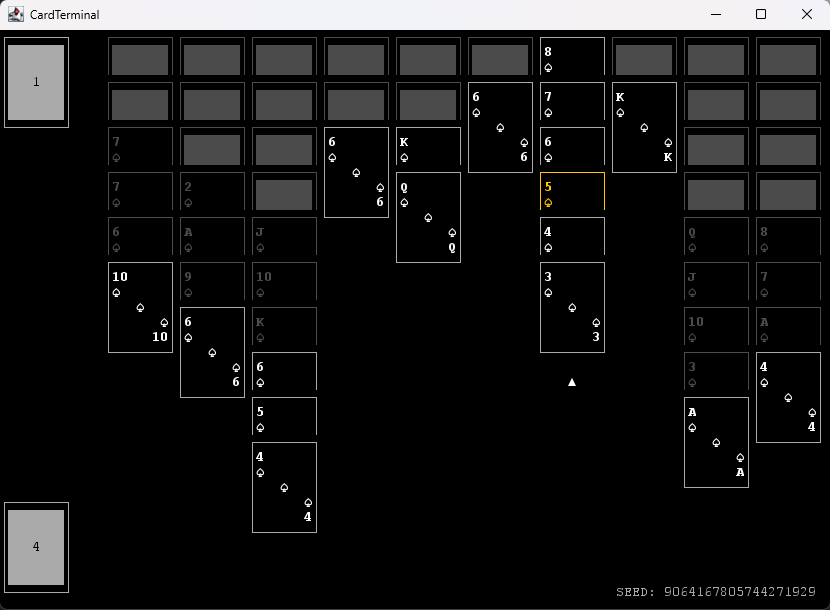
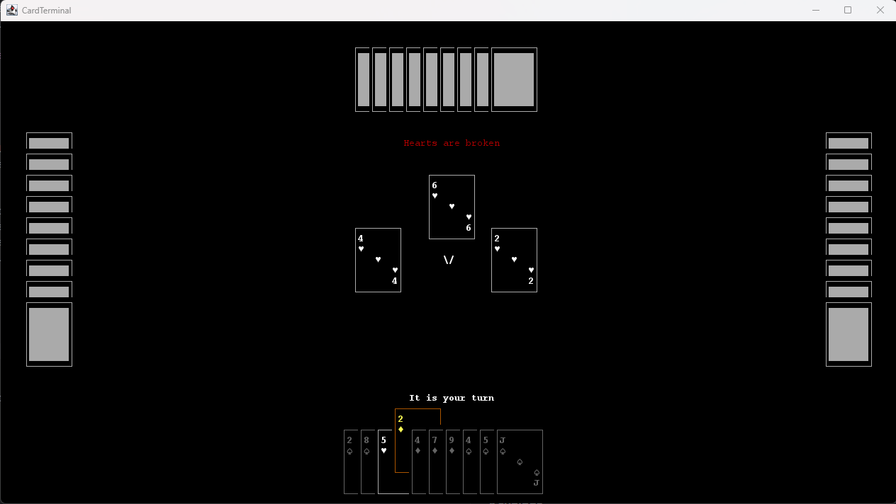

# CardTerminal
_like a card table, but terminal... get it??_

## Description
This project will eventually be expanded to many different card games.

## How it's built
__Built with Lanterna, packaged with Jpackage__

## Running
Go to releases, download and execute the suitable file for your operating system.
MSI for windows, DMG for mac, DEB for linux, and JAR if you have JRE installed.

# Games
## Solitaire

### Keybinds

- Arrows: Move cursor
- Space: Select card
- Backtick (`): Draw card
- Tab: select card on top of discard pile
- qwer: select foundation - q:hearts w:spades e:diamonds r:clubs
- dash (-): deselect
- Brackets ([/]): undo/redo
- F10: Restart game with new seed
- F12: Restart game with same seed
- Escape: Back to main menu

## Spider (Spider solitaire)

### Keybinds

- 1-9: Select column
- Arrows: move cursor (yellow)
- Space: Select/deselect card (turns card green)
- Backtick (`): Deal row
- dash (-): deselect
- Brackets ([/]): undo/redo
- F10: Restart game with new seed
- F12: Restart game with same seed
- Escape: Back to main menu

## Hearts

### Keybinds
- Arrows: move cursor (yellow)
- Space: select card (play card)
- Enter: pass cards (during passing phase)
- Escape: back to main menu

## Bugs
Create an issue on this project's repository

## Roadmap
- Gaps
- Freecell
- Spades
- Gin Rummy
