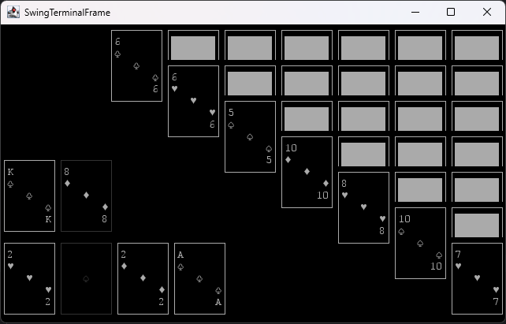

# CardTerminal
_like a card table, but terminal... get it??_

## Description
This project will eventually be expanded to many different card games.

## How it's built
__Built with Lanterna, packaged with Jpackage__

## Running
Go to releases, download and execute the suitable file for your operating system.
MSI for windows, DMG for mac, DEB for linux, and JAR if you have JRE installed.

# Games
## Solitaire

### Keybinds

- 1-9: Select column, or if column is already selected, select the card (vertically)
- 0: if column already selected, select last card in the pile
- Backtick (`): Draw card
- Space: select drawn card
- Tab: select card on top of discard pile
- qwer: select foundation - q:hearts w:spades e:diamonds r:clubs
- dash (-): deselect
- F10: Restart game with new seed
- F12: Restart game with same seed
- Escape: Instantly closes application

## Bugs
Create an issue on this project's repository

## Roadmap
- Gaps
- Freecell
- Hearts
- Spades